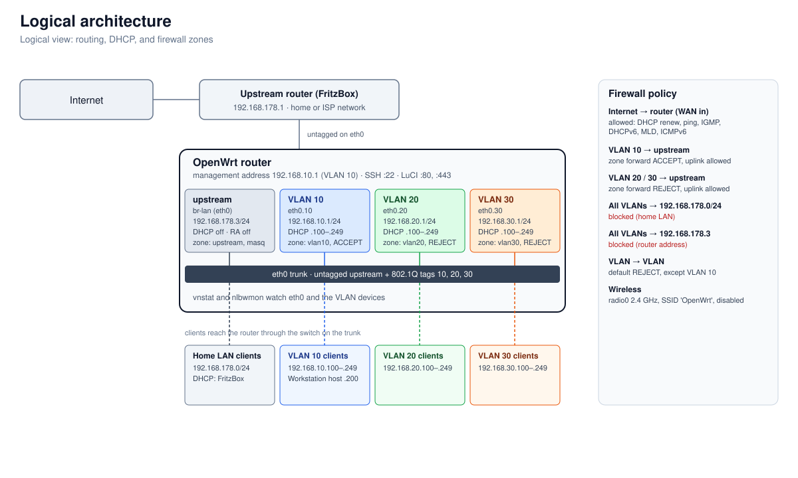

# labforge

Ansible project that configures an OpenWrt router through UCI, the OpenWrt
configuration system. The role's defaults are a generic OpenWrt baseline. Your
network (VLANs, firewall rules, addressing, DHCP, wireless) lives in
`inventory/group_vars/openwrt/network.yml`.

Every run is safe by design:

- a backup is taken before anything changes,
- changes are staged, shown as a diff, and committed only after you type `yes`,
- network and firewall changes arm an on-router timer that restores the old
  config unless you confirm reachability,
- a second backup is taken after a successful run.

## Network at a glance



The router sits between the upstream network (`192.168.178.0/24`, untagged on
`eth0`) and three VLANs (10, 20, 30) that use tagged sub-interfaces of the same
trunk. The diagram is drawn from `inventory/group_vars/openwrt/network.yml`.

## Layout

```
site.yml                              playbook: backup, reachability, Python, role, backup
ansible.cfg                           inventory, role path, SSH settings
inventory/hosts.yml                   the router (192.168.10.1), SSH connection settings
inventory/group_vars/openwrt/
  main.yml                            Python interpreter for the router
  network.yml                         YOUR network: VLANs, firewall rules, fixed sections
roles/openwrt/
  defaults/main.yml                   generic OpenWrt baseline and role behaviour
  tasks/main.yml                      wraps the phases in a block that always stops the Loki push
  tasks/phases.yml                    the phases of a run (commented)
  tasks/backup.yml                    backup of the router to backups/ on the controller
  tasks/validate*.yml                 checks on rollback settings, paths, list values
  tasks/build.yml                     builds the desired UCI sections from the variables
  tasks/stage.yml                     stages the edits and asks for approval
  tasks/rollback_prepare.yml          arms the rollback timer before a network/firewall commit
  tasks/rollback_confirm.yml          cancels the timer after the operator confirms
  handlers/main.yml                   reloads the services whose config was committed
  templates/*.sh.j2                   shell scripts rendered and run on the router
molecule/default/                     generic baseline on an OpenWrt rootfs container
molecule/network/                     your network on the same container
tests/render_scripts.yml              renders the router scripts for shellcheck
.github/workflows/ci.yml              lint and molecule pipeline
.yamllint.yml                         YAML lint settings
requirements-dev.txt                  ansible-core, ansible-lint, molecule, yamllint
```

## Requirements

On the controller (your Mac or a CI runner):

- Python 3.12 or newer
- Docker, for Molecule
- SSH access to the router as root with a key

```sh
python3 -m venv .venv
.venv/bin/pip install -r requirements-dev.txt
.venv/bin/ansible-galaxy collection install -r molecule/default/requirements.yml
```

On the router, `site.yml` installs the Python runtime that Ansible modules need
(`python3-light` and a few companion packages) from the OpenWrt feeds. Python is
used by the template and file modules.

## Usage

Check the playbook, then run it against the router with your SSH key:

```sh
.venv/bin/ansible-playbook site.yml --syntax-check
.venv/bin/ansible-playbook site.yml --private-key ~/.ssh/openwrt_ed25519
```

A run goes through these phases (details are commented in `roles/openwrt/tasks/phases.yml`):

1. **Backup (before).** `sysupgrade -b` archives the config, and the uncommitted
   UCI edits are saved too. Files go to `backups/router/`.
2. **Reachability, SSH key and Python.** SSH is checked. The public key in
   `openwrt_ssh_key_file` is added to the router's `/etc/dropbear/authorized_keys`
   if it is missing. The Python runtime is installed if missing.
3. **Validate and build.** The variables become the list of desired UCI sections.
4. **Plan.** The manifest of the last successful run shows what this role owns.
   Config that is no longer desired is pruned, but only if the manifest lists it.
5. **Stage.** All edits are written to the router's uncommitted UCI delta by one
   rendered script. Nothing is committed yet.
6. **Approve.** The run prints the `uci changes` diff per package and waits.
   Type `yes` to apply. Anything else reverts the staged edits and fails.
7. **Rollback arm.** For `network` or `firewall` changes, a timer is started on
   the router. It restores the old config after `openwrt_rollback_timeout`
   seconds (180 by default) unless confirmed.
8. **Commit and reload.** `uci commit` runs for each changed package, and the
   handlers reload the services.
9. **Confirm.** Type `yes` at the reachability prompt. That cancels the timer.
10. **Record.** The new manifest is written, so the next run knows what it owns.
11. **Backup (after).** Only after every step above succeeded and the router
    answers SSH again.

A dry run is the same playbook with no approval: when nothing is staged, the run
finishes without a prompt.

```sh
.venv/bin/ansible-playbook site.yml --private-key ~/.ssh/openwrt_ed25519 < /dev/null
```

With `< /dev/null` the approval prompt gets an empty answer, so any staged
change is reverted. Nothing is committed without an explicit `yes`.

## Configuration

| Where | What |
|---|---|
| `roles/openwrt/defaults/main.yml` | generic baseline, behaviour, paths |
| `inventory/group_vars/openwrt/network.yml` | your network: trunk, uplink, `openwrt_vlans`, `openwrt_firewall_rules`, `openwrt_site_sections` |
| `inventory/hosts.yml` | the router's address and SSH user |
| `openwrt_uci_custom_sections` | any other UCI section, by path (replaces or adds) |

Key settings (all in `roles/openwrt/defaults/main.yml` unless noted):

| Variable | Default | Meaning |
|---|---|---|
| `openwrt_manual_confirmation` | `true` | require `yes` before committing |
| `openwrt_rollback_enabled` | `true` | arm the timer for network/firewall commits |
| `openwrt_rollback_timeout` | `180` | seconds to confirm before the timer restores |
| `openwrt_reload_services` | `true` | reload services after commits |
| `openwrt_backup_enabled` | `true` | take the before and after backups |
| `openwrt_backup_dir` | `<repo>/backups` | where backups are stored on the controller |
| `openwrt_loki_url` | `''` | Grafana Cloud Loki push URL; with the token, streams router logs during a run |
| `openwrt_loki_user` | `''` | Loki instance ID (basic-auth user) |
| `openwrt_loki_token` | `''` | access token with `logs:write`; keep it in ansible-vault. Empty means no push |
| `openwrt_ssh_key_file` (in `inventory/group_vars/openwrt/main.yml`) | `~/.ssh/openwrt_ed25519.pub` | public key installed for root on the router; `''` skips it |

### Logs in Grafana Cloud Loki

When the URL and the token are set, the router streams its logs to Loki for the
length of the run. The token is written to the router for the run only and
removed in the `always` block of `site.yml`, so it is removed after a failure too.

Every role step logs with the tag `owrt.<step>[.<package>]`. Loki gets
these labels on each line:

| Label | Values |
|---|---|
| `job` | `openwrt` |
| `host` | `openwrt_loki_host` (the inventory name) |
| `app` | `openwrt-ansible` for role steps; the daemon name for other system logs |
| `step` | `run`, `stage`, `approve`, `commit`, `apply`, `rollback`, `record`, `report`; `system` for other daemons |
| `package` | the UCI package a step touched (`network`, `firewall`, `dhcp`, ...); `none` otherwise |

For example, `{job="openwrt", step="rollback", package="firewall"}` shows the firewall
rollback, and `{step="stage", package="network"} |= "network.vlan"` shows VLAN sections
being staged. Option values are never logged, because some are secrets.

The nightly safe-upgrade cron job runs outside a playbook run, so its logs are not streamed.

## SSH access

Ansible connects to the router with the private key only: its SSH options set
`PasswordAuthentication=no`. So the key must be on the router before password
login is turned off. `site.yml` makes sure of that. It adds the public key from
`openwrt_ssh_key_file` to `/etc/dropbear/authorized_keys` when it is missing, and
does nothing when it is present. Every run therefore also proves that key login works.

The backup set `dropbear.main.RootPasswordAuth` to `on`, so root can still log in
with a password. To turn password login off, set it to `'off'` in
`inventory/group_vars/openwrt/network.yml`, then run the playbook. Dropbear
applies it through the approval prompt, like any other change. Before you do,
check that key login works (the playbook's own connection already does this).
After it's off, password logins to root fail. If the key is ever lost, the
router is reachable only through the console or a reflash.

A VLAN entry in `network.yml` generates a device and interface, a DHCP pool (if
`dhcp` is set), a firewall zone, a forwarding to the uplink zone, and block rules.
If `openwrt_vlans` is empty, none of that is created. Only the baseline and the
site sections are applied.

## Backups

Each run writes three files per backup to `backups/router/`:

- `<label>-<time>.tar.gz`: the `sysupgrade -b` archive (config, dropbear keys, passwd)
- `<label>-<time>-uncommitted.txt`: the output of `uci changes`
- `<label>-<time>-delta.tar.gz`: the uncommitted delta store

Labels are `before` (the first task of the run) and `after` (the last task, after
a successful run). The files contain secrets: the root password hash, the
dropbear host keys and `authorized_keys`. The folder is git-ignored, and the
files are owner-only (`0600`). Do not copy them into the repository or share them.

## Tests

Molecule runs the role on OpenWrt's own arm64 rootfs image
(`openwrt/rootfs:armsr-armv8`), with no QEMU and no KVM. Set `OPENWRT_IMAGE` to
use another image. CI uses `openwrt/rootfs:x86-64`.

```sh
.venv/bin/molecule test -s default    # generic baseline, verify.yml
.venv/bin/molecule test -s network    # your network, verify.yml
```

Each scenario runs converge, verify, and an idempotence check, which must report
`changed=0`. The default scenario does not load `network.yml`.

## Lint

```sh
.venv/bin/yamllint .
.venv/bin/ansible-lint --profile production
.venv/bin/ansible-playbook site.yml --syntax-check
.venv/bin/ansible-playbook tests/render_scripts.yml -e render_dir=/tmp/rendered
shellcheck -s sh -x /tmp/rendered/*.sh
```

`tests/render_scripts.yml` renders the router scripts with the real defaults and
network variables, so shellcheck checks what would run on the router.

## CI

`.github/workflows/ci.yml` runs on every push and pull request:

- **lint**: yamllint, ansible-lint (production profile), the playbook syntax
  check, and shellcheck over the rendered router scripts.
- **molecule**: for each scenario (`default`, `network`), the test image is pulled
  first, then `molecule test` runs in a container. Nothing is installed on the
  runner beyond the test tools.

CI never contacts a router, and it has no secrets.

## Known limitations

- The role does not reduce options to the minimum. Some managed options restate
  OpenWrt's defaults, and some are device-specific (see the notes below).
  Removing one from the variables prunes it from the router on the next run, so
  removal needs a deliberate migration.
- `dropbear` allows root password login (`RootPasswordAuth`) because the backup
  had it. See "SSH access" above for turning it off.
- Rollback recovery is only tested in theory on the router. It is not yet
  exercised end to end, because the test container has no procd/ubus.
- Molecule cannot exercise the approval prompt or the rollback timer. The router
  dry run exercises the staging path.
